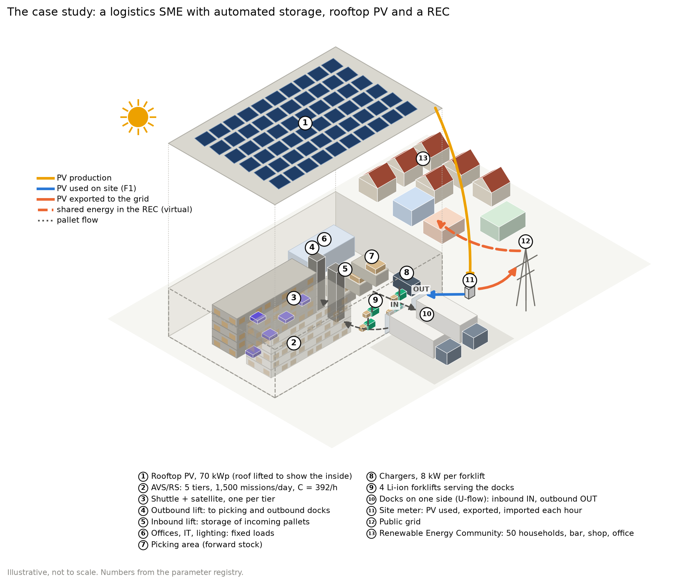
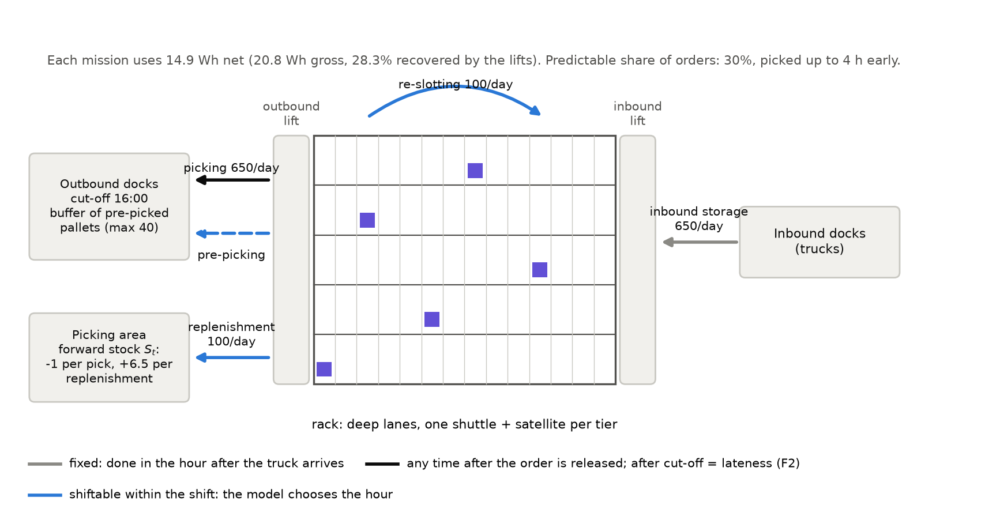
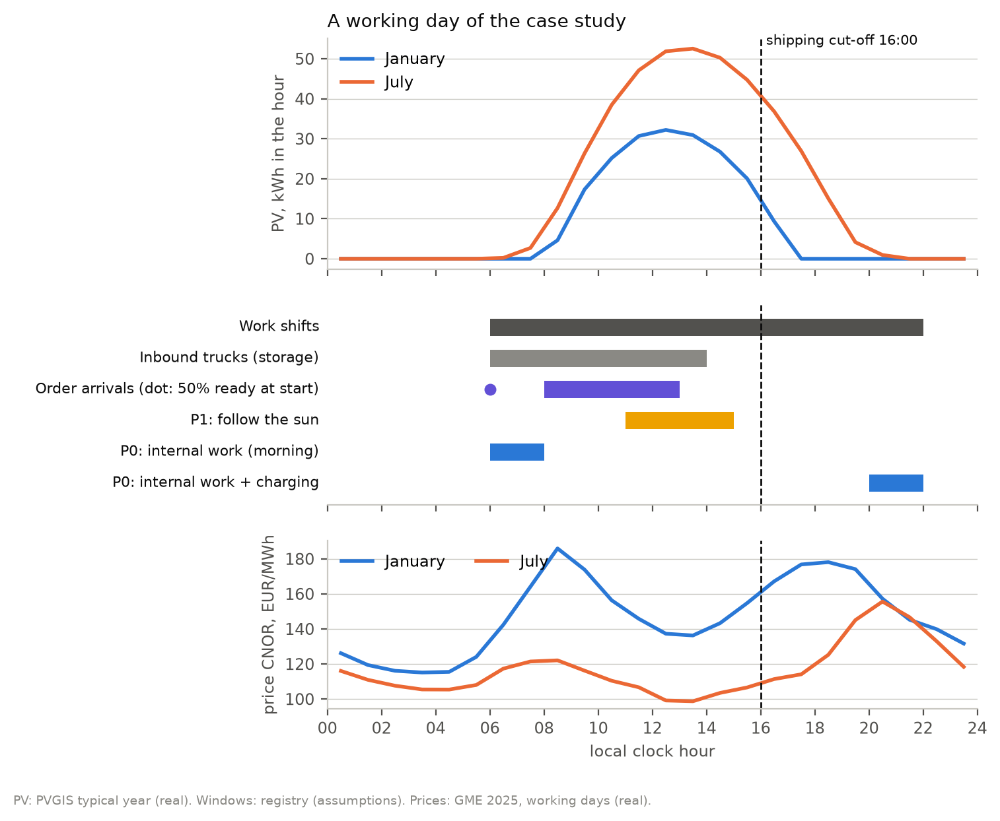
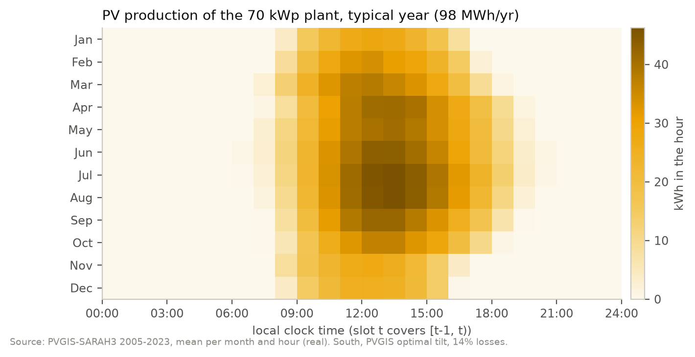
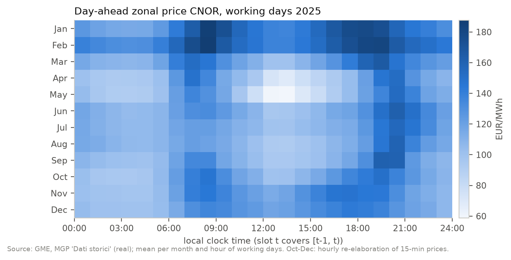
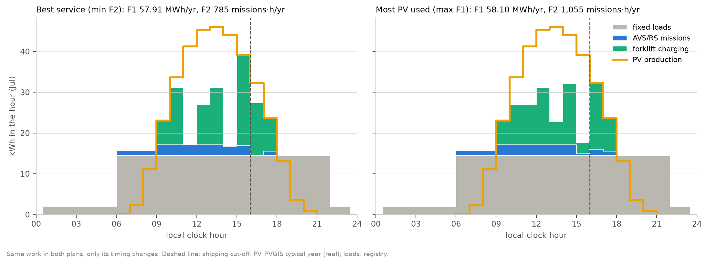
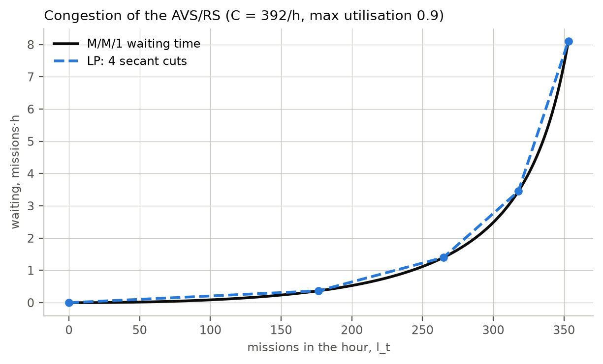

# Come funziona lo strumento — guida in parole semplici

> Guida per Ema, aggiornata a ogni fase. Ultimo aggiornamento: **Fase 3 (modello LP)**, 18/11/2026.
> I dettagli tecnici sono in inglese in [spec/specification_v1.md](spec/specification_v1.md),
> [decisions.md](decisions.md) e [data.md](data.md).

## 1. Che cosa fa, in cinque righe

Un magazzino con un sistema automatico (AVS/RS) e un impianto fotovoltaico sul tetto può
**spostare nel tempo una parte del proprio lavoro**. Se sposta il lavoro nelle ore di sole usa più
energia del suo impianto e ne compra meno dalla rete, ma rischia code e spedizioni in ritardo.
Lo strumento calcola **tutti i compromessi migliori** fra questi due aspetti (la "frontiera di
Pareto") e poi valuta quanto vale ciascun compromesso **con e senza una Comunità Energetica (CER)**.

## 2. Il caso studio



Vista "esplosa": il tetto con il fotovoltaico è sollevato e le due pareti davanti sono tolte, per vedere dentro.
I numeri nei cerchi rimandano alla legenda sotto la figura. Lo schema dei flussi di energia, più tecnico,
è in [figures/site_layout.png](figures/site_layout.png).

- Una PMI logistica a **Torrita di Siena** con un magazzino automatico per pallet, ispirato
  all'impianto Cassioli del tuo articolo del 2019: 5 piani, 2 elevatori (uno per l'ingresso, uno per l'uscita),
  uno shuttle con satellite per piano.
- **1.500 missioni al giorno** del magazzino automatico, 2 turni (06–22), dal lunedì al venerdì.
- **4 carrelli elevatori al litio** servono le baie di carico; si ricaricano a 8 kW.
- **Carichi fissi**: illuminazione, uffici, porte, compressore… (14,5 kW in turno, 2 kW fuori turno).
- **Fotovoltaico da 70 kWp** sul tetto (ridimensionato con il dato PVGIS: circa 100 MWh di consumo / 1.401 kWh/kWp).
- Il contatore misura ogni ora quanta energia solare il magazzino usa (**autoconsumo, F1**),
  quanta ne cede alla rete (**export**) e quanta ne compra (**import**).
- La **CER** (50 famiglie e 3 piccole attività: un bar, un negozio, un ufficio) non riceve energia fisicamente: conta come
  "condivisa" l'energia che il magazzino immette nelle stesse ore in cui gli altri membri consumano.

## 3. Le missioni: che cosa si può spostare e che cosa no



| Missione | Quante al giorno | Si può spostare? |
|---|---|---|
| Stoccaggio dei pallet in arrivo | 650 | **No**: va fatto entro l'ora dopo l'arrivo del camion |
| Prelievo per gli ordini (picking) | 650 | Solo **dopo** che l'ordine è arrivato; se lo faccio dopo il cut-off delle 16 è un **ritardo** |
| Pre-picking | il 30% degli ordini | **Sì**: gli ordini prevedibili si possono prelevare fino a 4 ore prima e tenere in un buffer (max 40 pallet) |
| Rifornimento dell'area picking | 100 | **Sì**, purché l'area non resti mai sotto la scorta minima |
| Re-slotting (riordino del magazzino) | 100 | **Sì**, in qualunque ora di turno |
| Ricarica dei carrelli | circa 87 kWh/giorno | **Sì**, purché i carrelli non restino scarichi e le baie siano sempre coperte |

## 4. Perché c'è un conflitto: una giornata tipo



- **In alto**: quanta energia produce il fotovoltaico ogni ora, a gennaio e a luglio (dati PVGIS reali).
  Il picco è fra le 11 e le 15.
- **Al centro**: quando succedono le cose. Gli ordini arrivano fino alle 13 e vanno spediti entro le 16:
  le ore di sole sono proprio quelle in cui il magazzino automatico è più impegnato con i prelievi.
  Le barre P0 e P1 sono le due politiche di confronto: P0 è la prassi attuale (lavori interni a inizio
  e fine turno), P1 fa "segui il sole" (tutto fra le 11 e le 15).
- **In basso**: il prezzo dell'energia all'ingrosso (GME). A mezzogiorno è più basso proprio perché c'è molto
  solare: per questo vendere l'energia in eccesso rende poco, e conviene usarla.

## 5. I due obiettivi, in parole semplici

- **F1, da massimizzare**: kWh di energia solare usati dal magazzino in un anno. Il consumo totale non cambia
  (il lavoro da fare è sempre lo stesso); cambia **quando** lo faccio. Più F1 significa meno energia comprata.
- **F2, da minimizzare**: produttività persa, in "missioni × ore" all'anno. Somma due cose:
  - il **ritardo** dei prelievi fatti dopo il cut-off (un pallet prelevato alle 18–19 vale 3);
  - l'**attesa in coda** nel magazzino automatico quando in un'ora gli si chiede troppo lavoro.

**La frontiera di Pareto** è l'elenco dei piani di lavoro per cui non si può migliorare un obiettivo
senza peggiorare l'altro. Per ciascun punto lo strumento dirà anche **quante missioni·ora di ritardo
"costa" ogni kWh solare in più**: è il prezzo ombra.

Il modello è un **problema di programmazione lineare** (LP): niente variabili intere, si risolve in pochi
secondi con HiGHS, un solver gratuito.

## 6. La CER entra dopo

La CER **non cambia le decisioni**. Prendo ogni piano della frontiera e calcolo quanto vale l'energia che
il magazzino non usa:
- **senza CER**: viene venduta al prezzo zonale orario;
- **con CER**: in più c'è l'incentivo (tariffa premio del DM 414/2023 e valorizzazione ARERA) sulla parte
  "condivisa" con gli altri membri.

C'è un effetto da mostrare nel paper: più energia uso in casa (F1 alto), meno ne esporto, quindi meno
incentivo CER. Lo strumento misurerà quanto incentivo si perde per ogni kWh autoconsumato in più.

## 7. Da dove vengono i numeri

**Regola**: nel codice non c'è nessun numero inventato. Ogni valore sta nel **registro dei parametri**
([config/params/base.yaml](../config/params/base.yaml)) con la sua fonte e il tipo di fonte:

| Tipo | Significato | Esempio |
|---|---|---|
| Reale | misurato, dataset pubblico, norma | prezzi GME, PVGIS, DM 414/2023 |
| Letteratura | pubblicato in un articolo | 75 kJ per missione (Guerrazzi et al. 2019) |
| Derivato | calcolato dal codice con una formula scritta | capacità C = 392 missioni/h |
| Stima | nostro valore, ancorato a fonti | consumo dei carrelli 4 kWh/h |
| Ipotesi | nostro valore senza fonte diretta: ha sempre un intervallo per la sensitività | 4 carrelli |
| Scelta di progetto | decisione dello studio | Torrita di Siena, anno 2025 |

La tabella completa, con fonte e pagina per ogni valore, si genera da sola: [params_base.md](params_base.md).
Se un dato manca, lo strumento **si rifiuta di partire** e dice che cosa serve.

## 8. I dati scaricati (Fase 2)

| Dato | Fonte | Cosa ne esce |
|---|---|---|
| Produzione PV | PVGIS (JRC), 2005–2023 | profilo medio ora per ora di ogni mese: **1.401 kWh/kWp all'anno**, cioè **98 MWh** per 70 kWp |
| Prezzi zonali | GME, zona Centro-Nord, 2025 | prezzo medio ora per ora, separato per giorni lavorativi e festivi: media **117 €/MWh** |
| Consumi di bar, negozio e ufficio | ELMAS (dati francesi 2018, CC BY) | forma oraria di ciascuno, scalata a 20 MWh/anno |
| Consumi delle famiglie | **mancante** (vedi sotto) | — |
| Calendario | festività nazionali 2025 | **251 giorni lavorativi** |





**I 12 giorni rappresentativi.** Invece di simulare 365 giorni, il modello usa **un giorno lavorativo
tipo per ogni mese**, pesato con il numero di giorni lavorativi di quel mese (gennaio vale 21, luglio 23…).
Sabati, domeniche e festivi non hanno decisioni: il magazzino consuma solo lo stand-by e tutta l'energia
solare va in rete; vengono contati a parte nei totali annui e nella CER.

**Due cose da sapere:**
1. Il PV produce più di quanto previsto dalla scheda (1.400 contro 1.300 kWh/kWp): il dato PVGIS è reale e
   coincide con il calcolatore ufficiale PVGIS (1.417). Per questo l'impianto è stato ridotto da 80 a 70 kWp.
2. **Il profilo delle famiglie di Besagni et al. 2020 non esiste nell'articolo**: la Figura 13 ("Load profiles
   of monitored households' clusters") è una copia della Figura 12 (probabilità d'uso dei microonde). Serve
   un'altra fonte. Come in Mariuzzo et al. (2023), il profilo si può ricostruire "dal basso" dagli
   elettrodomestici (dati di Nazemi et al. 2021 e Cruz et al. 2019): servono i due articoli. Finché manca,
   il calcolo della CER resta bloccato (serve solo dalla Fase 5).

## 9. Il modello risolto: primi risultati (Fase 3)

Il modello lineare (vincoli V1–V9 della specifica) si risolve in **circa 1 secondo** per i 12 giorni
rappresentativi. Ogni soluzione viene controllata automaticamente: bilanci energetici ora per ora, tutte le
missioni fatte, batterie dei carrelli mai sotto il 20%, area picking mai sotto la scorta minima, buffer rispettato.



| | Miglior servizio (min F2) | Massimo solare usato (max F1) |
|---|---|---|
| F1, solare autoconsumato | 57.912 kWh/anno | 58.103 kWh/anno |
| F2, produttività persa | 785 missioni·h/anno (solo coda, zero ritardi) | 1.055 missioni·h/anno |

**Cosa vuol dire, in parole semplici.**
- Il magazzino consuma **95 MWh/anno** e il fotovoltaico da 70 kWp ne produce **98**: il 59% del solare viene
  usato in casa e copre il 61% dei consumi.
- La **ricarica dei carrelli** (la parte verde) è il grande carico spostabile e il modello la mette nelle ore di sole
  *anche quando pensa solo al servizio*, perché spostarla non crea code né ritardi.
- Le **missioni del magazzino automatico** (la striscia blu) consumano pochissimo: circa 15 Wh l'una, 22 kWh al
  giorno in tutto. Spostarle verso il sole fa guadagnare solo **circa 190 kWh/anno** (0,3%) e costa il 34% di coda
  in più.
- Quindi, nel caso base, **il compromesso fra solare e produttività esiste ma è piccolo**. È già una risposta
  alla prima domanda del paper; l'analisi di sensitività (Fase 6) mostrerà quando diventa importante: più missioni,
  sistemi meno efficienti, capacità minore.
- Il **pre-picking** possibile è di 97,5 prelievi al giorno (non 195): gli ordini arrivati la sera prima sono già
  disponibili alle 6 e non si possono anticipare. Il modello ne anticipa in media 37 al giorno.



La curva nera è la formula classica della coda (M/M/1): l'attesa esplode quando il magazzino si avvicina alla
capacità. Il modello lineare la approssima con 4 segmenti (linea tratteggiata), esatti nei punti blu.

## 10. A che punto siamo

| Fase | Contenuto | Stato |
|---|---|---|
| 0 | Struttura del progetto, ambiente, test automatici | fatta |
| 1 | Registro dei parametri con fonti, controllo di provenienza | fatta |
| 2 | Dati: PV, prezzi, consumi, calendario, giorni rappresentativi | fatta (manca il profilo delle famiglie) |
| 3 | Il modello LP con i vincoli V1–V9 | fatta |
| 4 | Frontiera di Pareto, prezzi ombra, politiche P0/P1 | da fare |
| 5 | CER ed economia (condizioni B e C) | da fare |
| 6 | Scenari di sensitività, cluster SLURM | da fare |
| 7 | Dashboard interattiva | da fare |
| 8 | Documentazione finale, riproducibilità | da fare |

## 11. Piccolo glossario

- **AVS/RS**: magazzino automatico con veicoli autonomi; qui elevatori, shuttle e satelliti.
- **Shuttle e satellite**: lo shuttle corre lungo il corridoio del piano, il satellite entra nel canale profondo a
  prendere o posare il pallet.
- **Cut-off**: l'ora entro cui un ordine deve essere pronto per la spedizione (16:00).
- **Capacità C**: missioni all'ora che il magazzino automatico riesce a fare (392); oltre il 90% di
  utilizzo il modello non va.
- **Coda M/M/1**: formula classica che dice quanto cresce l'attesa quando un sistema è quasi pieno; nel modello
  è approssimata con 4 rette.
- **Frontiera di Pareto / AUGMECON**: il metodo per trovare tutti i compromessi migliori fra due obiettivi.
- **Prezzo ombra**: quanto peggiora F2 se chiedo 1 kWh in più di F1.
- **TIP**: tariffa incentivante premio della CER (DM 414/2023).

## 12. Comandi utili

```bash
conda activate wpvrec
wpvrec params validate          # controlla il registro e dice che cosa manca
wpvrec params table -o docs/params_base.md   # rigenera la tabella dei parametri
wpvrec data download            # scarica PVGIS, GME, ELMAS (solo se non già presenti)
wpvrec data process             # produce i profili e stampa i controlli
wpvrec figures                  # rigenera tutte le figure di docs/figures
wpvrec solve                    # risolve il modello (min F2) e controlla i bilanci
wpvrec solve --objective max_F1 # risolve massimizzando il solare autoconsumato
pytest                          # esegue i test
```
